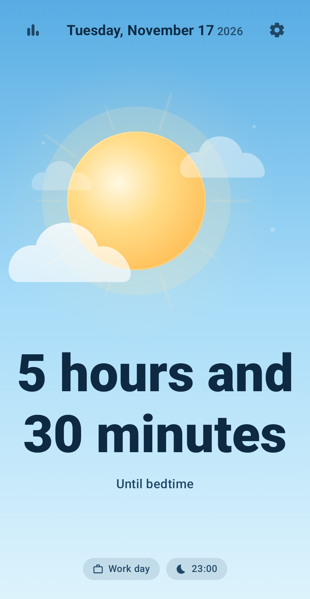
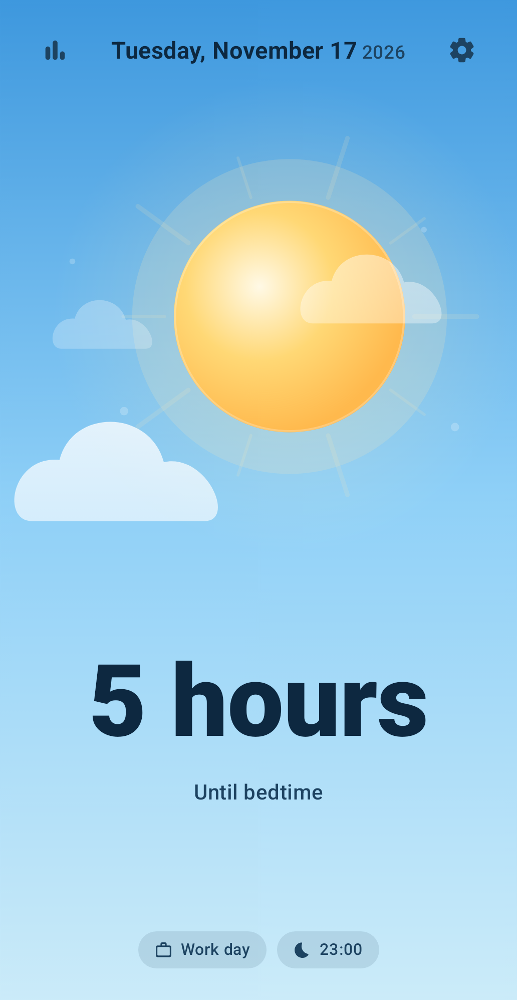
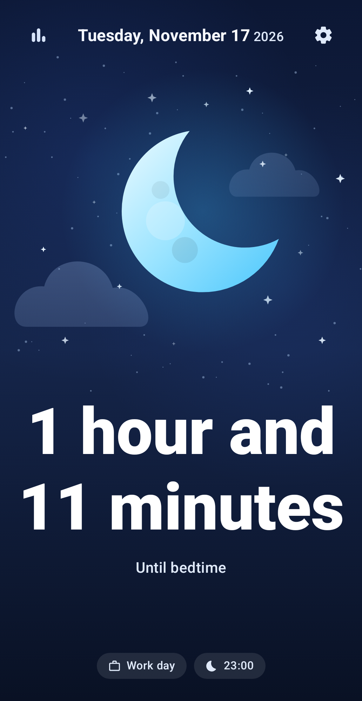
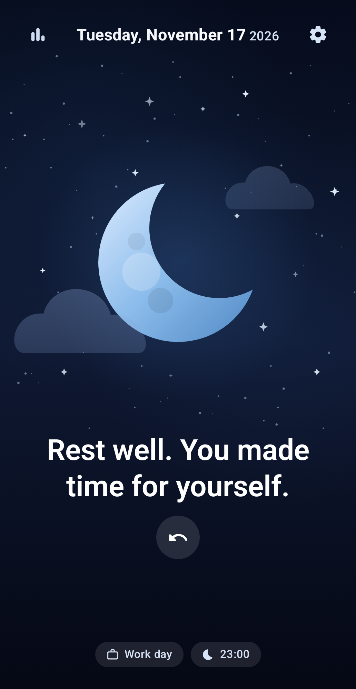
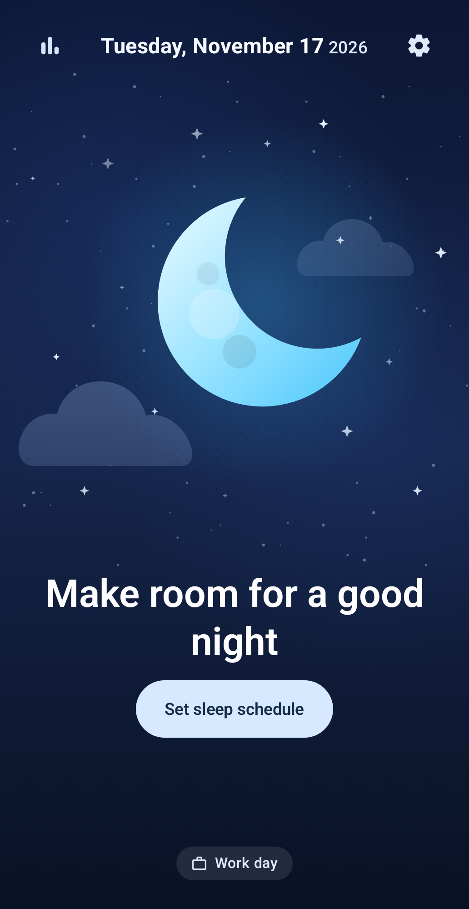
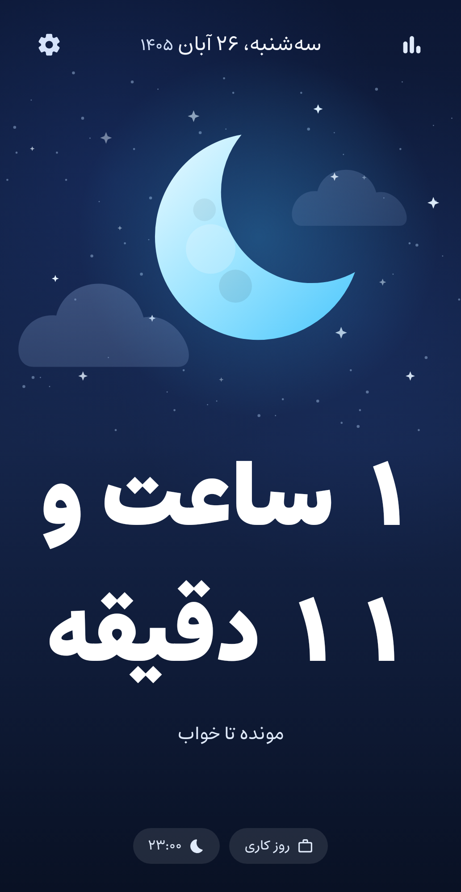
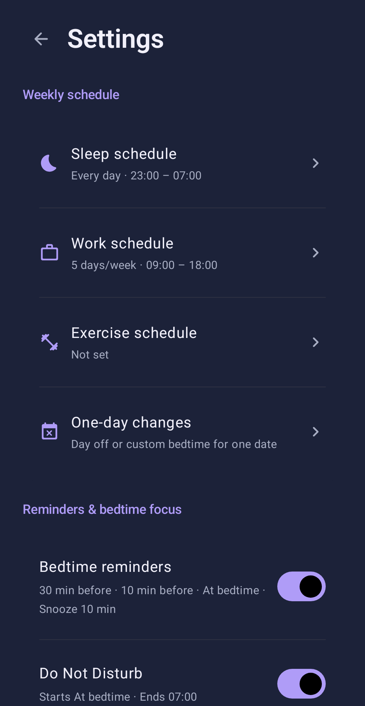
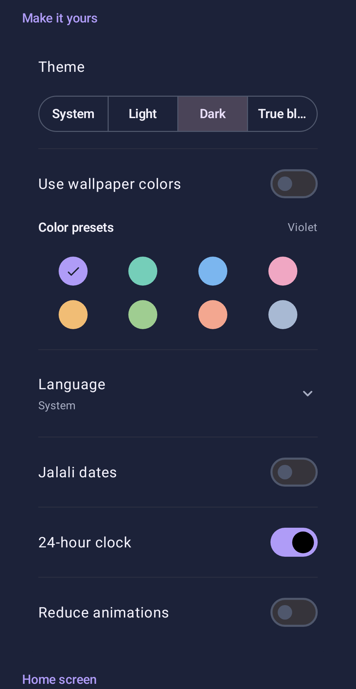

# 🌙 sleepino

A native, offline-first Android bedtime and personal time-budget assistant built with **Kotlin** and **Jetpack Compose** in **English** and **Persian (فارسی)**.

Its visual direction is calm, spacious, and dashboard-first: a full-screen celestial bedtime sky that evolves through nine solar and sleep phases, gentle violet/teal accents, clear weekly time-budget summaries, and focused bottom-sheet editors—with **no accounts, no ads, no analytics, and no backend**.

---

## 📸 Screenshots — All App States

### Solar & Daytime Phases

| Dawn (`05:00–06:59`) | Morning (`07:00–10:59`) | Day (`11:00–15:59`) | Golden Hour (`16:00–17:59`) | Twilight (`18:00–19:59`) |
| :---: | :---: | :---: | :---: | :---: |
|  |  |  |  |  |

### Night & Bedtime Lifecycle States

| Night (`20:00–04:59`) | Wind-Down (`-30 min`) | Snoozed | Past Bedtime (Overdue) | Resting (Confirmed) |
| :---: | :---: | :---: | :---: | :---: |
|  |  |  |  |  |

### Free / Rest Days, Setup & Localization

| Rest Day (Day Sky) | Rest Day (Past Bedtime) | Unconfigured Schedule | Persian RTL & Jalali |
| :---: | :---: | :---: | :---: |
|  |  |  |  |

### Reports & Settings

| Weekly Time Balance | Settings — Schedule & Focus | Settings — Appearance & Home |
| :---: | :---: | :---: |
|  |  |  |

---

## ✨ Features

### 🌙 Celestial Bedtime Dashboard
- **Dynamic Sky Countdown**: Full-bleed animated sky canvas spanning nine phases—**Dawn**, **Morning**, **Day**, **Golden Hour**, **Twilight**, **Night**, **Wind-Down**, **Overdue**, and **Resting**—with smooth color transitions.
- **Dark Eclipse Overdue Experience**: When bedtime passes, the overdue state shifts into a soothing dark obsidian-midnight sky featuring a breathing lunar eclipse, an orbiting bedtime clock trail, falling sandman stardust motes, and rising `Z` sleep cues to nudge you to bed without harsh glare.
- **Fluid Hand-Crafted Motion**: Animated sun rays, gliding morning birds, twinkling stars, shooting stars, drifting layered clouds, and breathing halos—with full **Reduce motion** support.
- **Sleep & Snooze Controls**: **I’m going to sleep** and **Snooze** buttons appear 30 minutes before bedtime and remain reachable while overdue, alongside cancellable snooze and one-tap confirmation with icon-only undo.
- **Intuitive Navigation**: Swipe horizontally (or tap the corner bar-chart icon) to open weekly Reports & Statistics, and tap the corner gear icon to open Settings.

### ⏰ Flexible Schedule & Time-Budget Management
- **Independent Weekly Schedules**: Dedicated planners for **Sleep**, **Work**, and **Exercise**.
- **Circular Time Picker**: Fast weekday-batch bedtime/wake setup plus per-day customization.
- **Overnight & Shift Support**: Handles overnight intervals, work mid-shift breaks, target sleep durations, and single-date overrides (days off, explicit work on holidays, or custom bedtimes).
- **Personal Time Budget**: Mutually exclusive daily and weekly breakdowns (`Sleep` → `Work` → `Exercise` → `Free`) with remaining free-time tracking, DST-safe `java.time` boundaries, and work/rest day badges.

### 🔔 Smart Reminders & Sleep Protection
- **Multi-Stage Reminders**: Configurable pre-bedtime reminder stages, bounded overdue repeat intervals, and snooze limits capped before wake time.
- **Reliable Scheduling**: `AlarmManager` scheduling with optional exact-alarm (`SCHEDULE_EXACT_ALARM`) support, automatic reconstruction across reboots, timezone shifts, clock changes, and app updates, plus a 12-hour `WorkManager` recovery sweep.
- **App-Owned Do Not Disturb**: Automated `AutomaticZenRule` on Android 10+ that preserves other system rules and respects user-disabled or deleted rules.
- **Wellbeing & Activity Awareness**: Optional Usage Access sampling at reminder times for inactivity-based overdue suppression and distracting-app alerts, plus a direct shortcut to Android Digital Wellbeing—without storing any usage history.
- **Duplicate-Safe Confirmation**: Room primary-key protection prevents duplicate bedtime records across notifications, home shortcuts, and the Quick Settings tile.

### 🌍 Localization & Calendar System
- **Bilingual Experience**: Complete **English** and **Persian (فارسی)** support with automatic LTR/RTL layout direction.
- **Persian Typography & Digits**: Bundled **Estedad** font with automatic Persian numeral formatting.
- **Jalali & Gregorian Calendars**: Built-in Solar Hijri (Jalali) and Gregorian date formatting, 12-hour/24-hour clocks, configurable week start, and independent timezone/holiday-region selection.
- **Accurate Holiday Engine**: Astronomical Iranian lunar calendar mappings and 28 bundled recurrence holiday rules, with explicit provisional labeling outside validated year coverage.

### 🎨 Personalization & Theming
- **Curated Color Palettes**: 8 distinctive accent color presets (`Violet`, `Rose`, and more).
- **Display Modes**: System, **Light**, **Dark**, **True Black (AMOLED)**, and Android 12+ **Material You** dynamic wallpaper colors.
- **Customizable Home Badges**: Toggle visibility of the calendar year, bedtime chip, and work/rest day badge.
- **Accessibility**: Minimum `48dp` touch targets, merged semantic descriptions, dynamic font scaling, and reduced-motion snapping.

### 📱 Android System Integrations
- **Home Screen Widgets**: Jetpack **Glance** widgets for quick bedtime countdowns and remaining free-time tracking.
- **Quick Settings Tile**: One-tap sleep confirmation tile (`BedtimeTile`) directly in Android’s Quick Settings shade.
- **App Shortcut**: `SLEEP_FROM_SHORTCUT` action for instant bedtime confirmation.

### 🔒 100% Private & Offline-First
- **Zero Tracking**: No account, no ads, no analytics, no telemetry, and no backend servers.
- **Local Storage**: All schedules and history stay on-device via **Room** (bedtime/routine records) and **DataStore** (preferences and active session).
- **Data Portability**: Full JSON backup & restore through Android’s Storage Access Framework document picker, plus locally imported holiday JSON updates.

---

## 🛠️ Tech Stack & Architecture

| Layer | Technologies & Libraries |
| :--- | :--- |
| **Language & Build** | **Kotlin** `2.2.21` · **Android Gradle Plugin** `9.5.3` · **KSP** `2.3.6` · **JDK 21** (JVM 17 target) · **R8** release minification |
| **Modules** | `:core` (pure Kotlin/JVM immutable models, interval algebra, holiday/calendar engine, reminder state machine) · `:app` (Android UI & platform integrations) |
| **UI & Animation** | **Jetpack Compose** (`compose-bom` `2026.03.01`) · **Material 3** (`material3`, `material-icons-extended`) · Custom `Canvas` celestial graphics · **Material You** Dynamic Color |
| **Architecture & DI** | Unidirectional `StateFlow` MVVM (`AppViewModel`) · **Dagger Hilt** `2.57.2` · **Navigation Compose** `2.9.7` · **Kotlin Coroutines** `1.10.2` |
| **Persistence** | **Room** `2.8.4` (`room-runtime`, `room-ktx`, checked-in schema v1) · **DataStore Preferences** `1.2.1` · **`kotlinx.serialization` JSON** `1.9.0` |
| **Android Platform** | **WorkManager** `2.11.1` · **Jetpack Glance** `1.1.1` (`glance-appwidget`, `glance-material3`) · `AlarmManager` · `AutomaticZenRule` (DND) · `UsageStatsManager` · `TileService` · Storage Access Framework |
| **Testing & Lint** | **JUnit** `4.13.2` · **Compose UI Test** (`ui-test-junit4`) · **Android Lint** (`abortOnError = true`, `checkReleaseBuilds = true`) |

No production history or personal schedule is prefilled. Onboarding can be completed with sections unconfigured; schedules are saved only through explicit editing.

---

## 🚀 Open and Run

1. Install a current stable Android Studio with **JDK 21**, Android SDK **36**, and Build Tools **36.0.0**.
2. Open this repository as a Gradle project and allow dependency sync.
3. Run the `app` configuration on Android **8.0 / API 26 or newer**.

From a terminal:

```bash
./gradlew :core:test :app:lintDebug
./gradlew :app:assembleDebug
```

On Windows use `gradlew.bat`. The debug APK is written to `app/build/outputs/apk/debug/app-debug.apk`. No signing secrets are needed. For a local release build (universal + per-ABI splits) use `./gradlew :app:assembleRelease`.

### 🔄 CI/CD and Releases

- **Android CI (`android.yml`)**: Runs automatically on pull requests and pushes to `main`. Executes unit tests (`:core:test`, `:app:testDebugUnitTest`), lint (`:app:lintDebug`), and builds the debug APK artifact.
- **Automated Release Pipeline (`release.yml`)**: Automatically builds, signs, hashes, and publishes release assets whenever `versionName` in `app/build.gradle.kts` is bumped on `main`, a `v*` tag (e.g. `v1.1.0`) is pushed, a GitHub Release is published, or `workflow_dispatch` is triggered.
  - Produces signed **Universal** and per-architecture APKs (`universal`, `arm64-v8a`, `armeabi-v7a`, `x86_64`, `x86`), individual `.sha256` checksum files, a combined `sleepino-<tag>-SHA256SUMS.txt` manifest, and an automated SHA-256 verification table (including signing certificate SHA-256) in the release notes.
  - If GitHub Secrets (`KEYSTORE_BASE64`, `KEY_ALIAS`, `KEY_PASSWORD`, `KEYSTORE_PASSWORD`) are configured, all APKs are signed with your production keystore; otherwise, a release signing key is automatically generated so every APK is immediately installable.

---

## 📅 Holiday Data

Holiday rules come **only** from [`persian-calendar/events`](https://github.com/persian-calendar/events), commit **503bb203ac50a0ca79f36840ef74e1eee7eabb1d**, filtering exactly `type == "Iran" && holiday == true`. The bundled adapter has **28 rules**, supports simple and end-of-month recurrence, honors beginning/end Persian-year metadata, and removes all names/descriptions. No GPL app or calendar implementation is copied.

Lunar dates follow Iranian mappings, not the Saudi `HijrahDate` calendar. Published **1405** date-conversion anchors were transcribed from the University of Tehran Calendar Center’s 1405 calendar; older mapping data comes from the CC0 `roozbehp/qamari` calendar-center dataset. The published-year coverage is **2026-03-21 through 2027-03-20**, inclusive. Published future lunar dates remain subject to official revision; they are not claims of confirmed future moon sightings.

Outside validated coverage, status is **unknown**, and the dashboard explicitly labels the budget provisional. Unknown days retain planned work rather than inventing holidays or asserting they are ordinary workdays. See [holiday provenance and updates](docs/HOLIDAYS.md).

---

## ⚡ Performance

Responsive startup, swipes, and settings controls are product requirements. The home view refreshes at minute boundaries and at snooze expiration. It reuses daily and weekly schedule calculations between clock updates, and the reports page loads other weeks off the UI thread. Settings loads installed apps when their picker opens. Judge startup and gesture performance on a release build with R8 enabled.

---

## ✅ Verification & Documentation

The JVM time engine has automated tests for overlapping reservations, overnight work, sleep ownership, holidays/overrides, every week start, remaining budgets, 23/25-hour days, DST gaps/overlaps, date conversion, validity limits, and reminder transitions. Android compilation and lint should be run with the commands above. Device/emulator permission, OEM notification, DND, widget, and accessibility checks are listed in [the device checklist](docs/DEVICE_TESTING.md); no device certification is implied by source-level checks.

See [visual design and motion](docs/DESIGN.md), [architecture](docs/ARCHITECTURE.md), [platform behavior](docs/PLATFORM.md), [privacy](PRIVACY.md), and [third-party acknowledgments](NOTICE.md).

The application source is private and has no open-source license grant. Third-party files retain their individual licenses.
