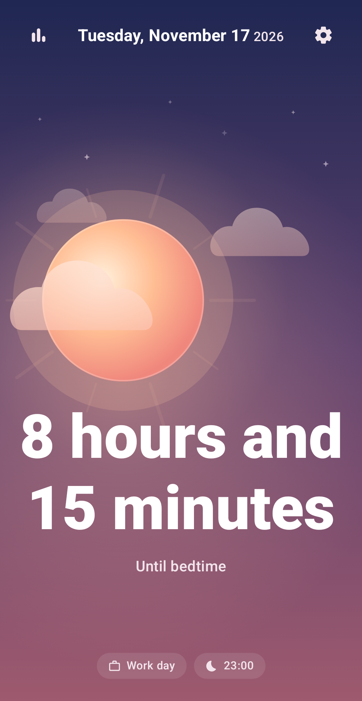
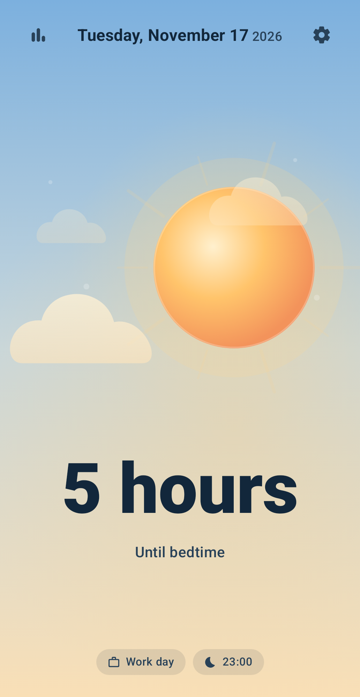
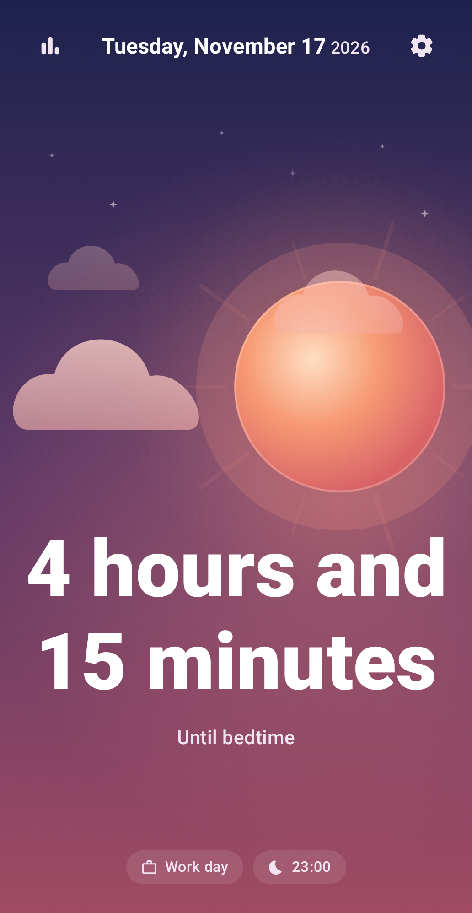
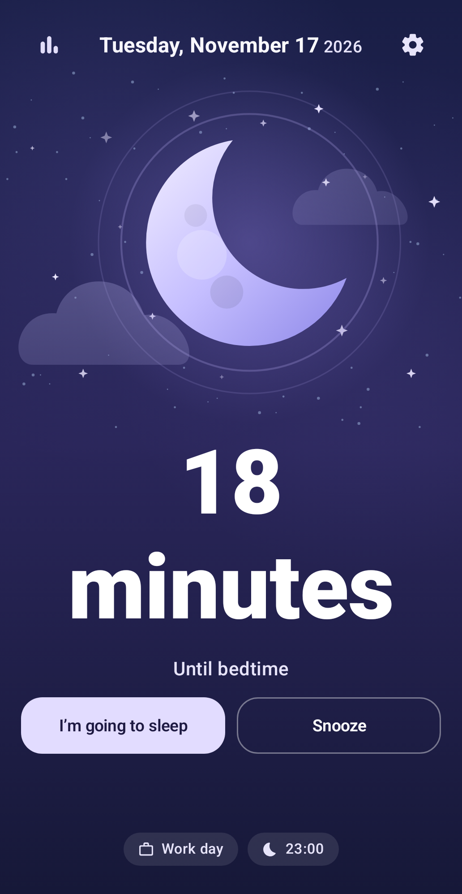
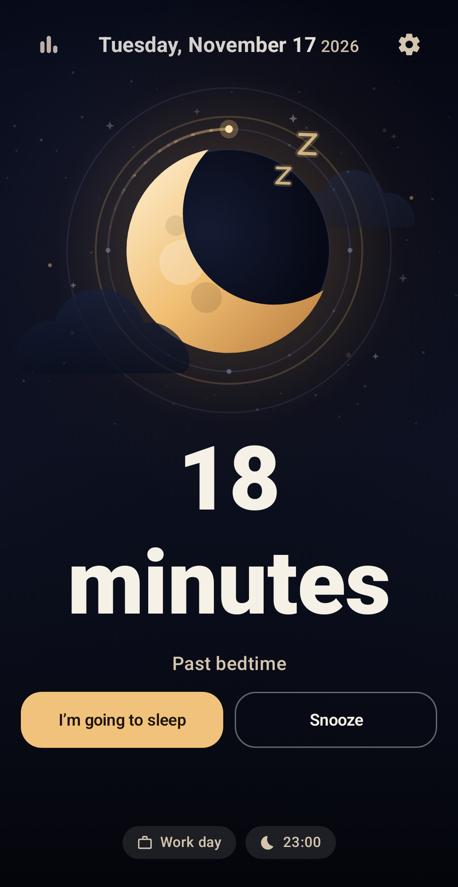
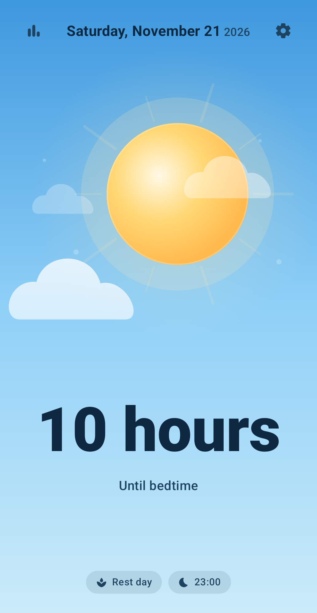
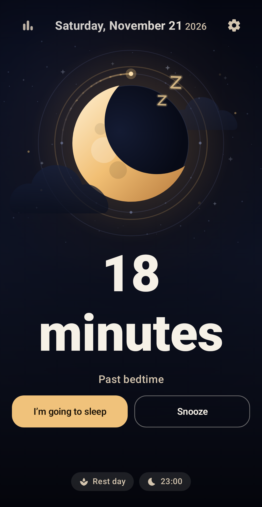
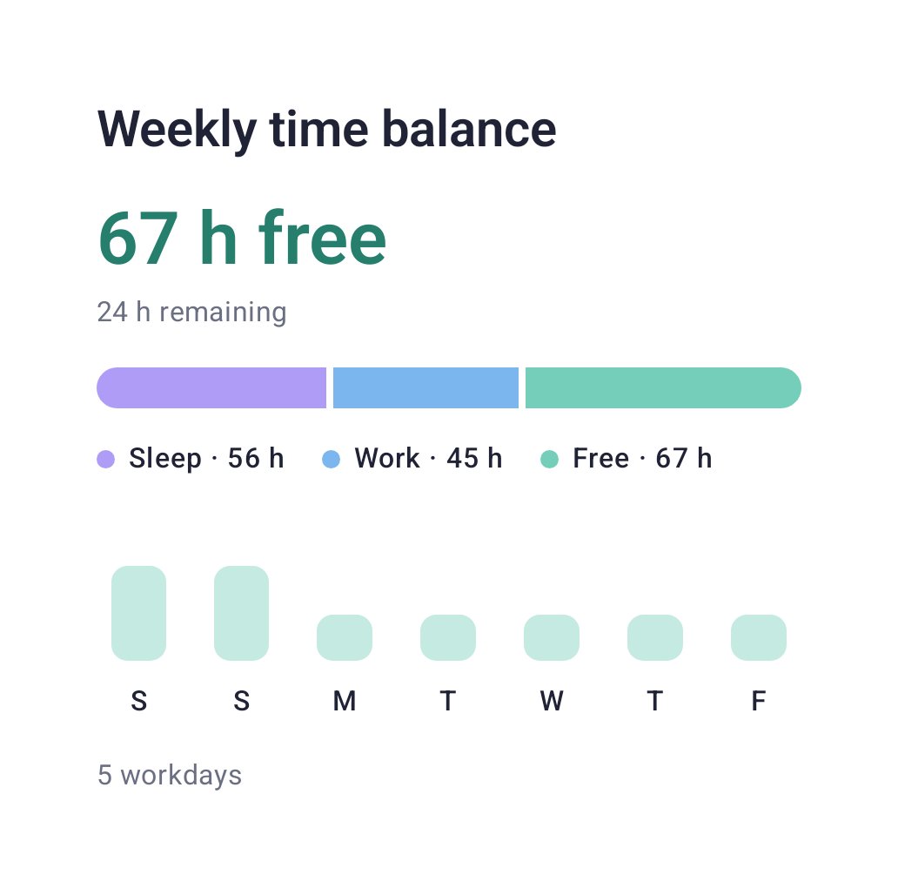

# sleepino

A native, offline Android bedtime and personal time-budget assistant built with **Kotlin** and **Jetpack Compose** in **English** and **Persian**.

Its visual direction is calm, spacious, and dashboard-first: a full-screen celestial bedtime sky that evolves throughout the day, gentle violet/teal accents, clear weekly time-budget summaries, and focused bottom-sheet editors—with **no account, ads, analytics, or backend**.

---

## Screenshots — All App States

### Solar & Daytime Phases

| Dawn (`05:00–06:59`) | Morning (`07:00–10:59`) | Day (`11:00–15:59`) | Golden Hour (`16:00–17:59`) | Twilight (`18:00–19:59`) |
| :---: | :---: | :---: | :---: | :---: |
|  |  |  |  |  |

### Night & Bedtime Lifecycle States

| Night (`20:00–04:59`) | Wind-Down (`-30 min`) | Snoozed | Past Bedtime (Overdue) | Resting (Confirmed) |
| :---: | :---: | :---: | :---: | :---: |
|  |  |  |  |  |

### Free / Rest Days, Setup & Localization

| Rest Day (Day Sky) | Rest Day (Past Bedtime) | Unconfigured Schedule | Persian RTL & Jalali |
| :---: | :---: | :---: | :---: |
|  |  |  |  |

### Reports & Settings

| Weekly Time Balance | Settings — Schedule & Focus | Settings — Appearance & Home |
| :---: | :---: | :---: |
|  |  |  |

---

## Features

- **Dynamic Sky & Bedtime Countdown**
  - Full-page animated sky spanning nine phases: **Dawn**, **Morning**, **Day**, **Golden Hour**, **Twilight**, **Night**, **Wind-Down**, **Overdue**, and **Resting**.
  - When bedtime passes, the **Overdue** state shifts into a dark obsidian-eclipse sky with an orbiting bedtime trail, falling sandman stardust, calm breathing rings, and rising `Z` sleep cues to gently nudge you to bed without harsh glare.
  - **I’m going to sleep** and **Snooze** actions appear 30 minutes before bedtime and remain available while overdue. Swipe horizontally (or tap the corner icon) for Reports, and open Settings from the top corner.
- **Flexible Weekly & Override Schedules**
  - Independent weekly **Sleep**, **Work**, and **Exercise** schedules.
  - Apply a bedtime and wake time across selected weekdays with the circular picker, or customize individual days with overnight intervals, work breaks, target sleep durations, and single-date overrides.
- **Smart Reminders, Snooze & Do Not Disturb**
  - Custom reminder stages, bounded overdue repeats, cancellable snooze, duplicate-safe reported-bedtime confirmation, and icon-only undo.
  - `AlarmManager` scheduling with optional exact-alarm access, boot/timezone/clock rescheduling, and a `WorkManager` recovery sweep.
  - Optional activity-aware overdue suppression with scheduled fallback, optional distracting-app awareness at reminder times, and a shortcut to Android Digital Wellbeing.
  - App-owned Do Not Disturb rule on Android 10+, preserving other rules and respecting user-disabled or deleted rules.
- **Storage, Localization & System Integration**
  - Room bedtime/routine history, DataStore configuration, JSON backup/restore via Android’s file picker, and locally imported holiday updates.
  - English and Persian with automatic RTL/LTR layouts, bundled **Estedad** and system sans-serif typography, Persian numerals, Jalali calendar dates, 12/24-hour clocks, eight accent presets, Light/Dark/AMOLED themes, dynamic colors, and **Reduce motion** support.
  - Bedtime and free-time home screen widgets, plus a Quick Settings sleep-confirmation tile.

No production history or personal schedule is prefilled. Onboarding can be completed with sections unconfigured; schedules are saved only through explicit editing.

---

## Open and Run

1. Install a current stable Android Studio with **JDK 21**, Android SDK **36**, and Build Tools **36.0.0**.
2. Open this repository as a Gradle project and allow dependency sync.
3. Run the `app` configuration on Android **8.0 / API 26 or newer**.

From a terminal:

```bash
./gradlew :core:test :app:lintDebug
./gradlew :app:assembleDebug
```

On Windows use `gradlew.bat`. The debug APK is written to `app/build/outputs/apk/debug/app-debug.apk`. No signing secrets are needed. For a local release build use `./gradlew :app:assembleRelease`.

### CI/CD and Releases

- **Android CI (`android.yml`)**: Runs automatically on pull requests and pushes to `main`. Executes unit tests (`:core:test`, `:app:testDebugUnitTest`), lint (`:app:lintDebug`), and builds the debug APK artifact.
- **Automated Release Pipeline (`release.yml`)**: Automatically builds, signs, hashes, and publishes release assets whenever `versionName` in `app/build.gradle.kts` is bumped on `main`, a `v*` tag (e.g. `v1.1.0`) is pushed, a GitHub Release is published, or `workflow_dispatch` is triggered.
  - Produces signed **Universal** and per-architecture APKs (`universal`, `arm64-v8a`, `armeabi-v7a`, `x86_64`, `x86`), individual `.sha256` checksum files, a combined `sleepino-<tag>-SHA256SUMS.txt` manifest, and an automated SHA-256 verification table (including signing certificate SHA-256) in the release notes.
  - If GitHub Secrets (`KEYSTORE_BASE64`, `KEY_ALIAS`, `KEY_PASSWORD`, `KEYSTORE_PASSWORD`) are configured, all APKs are signed with your production keystore; otherwise, a release signing key is automatically generated so every APK is immediately installable.

---

## Holiday Data

Holiday rules come **only** from [`persian-calendar/events`](https://github.com/persian-calendar/events), commit **503bb203ac50a0ca79f36840ef74e1eee7eabb1d**, filtering exactly `type == "Iran" && holiday == true`. The bundled adapter has **28 rules**, supports simple and end-of-month recurrence, honors beginning/end Persian-year metadata, and removes all names/descriptions. No GPL app or calendar implementation is copied.

Lunar dates follow Iranian mappings, not the Saudi `HijrahDate` calendar. Published **1405** date-conversion anchors were transcribed from the University of Tehran Calendar Center’s 1405 calendar; older mapping data comes from the CC0 `roozbehp/qamari` calendar-center dataset. The published-year coverage is **2026-03-21 through 2027-03-20**, inclusive. Published future lunar dates remain subject to official revision; they are not claims of confirmed future moon sightings.

Outside validated coverage, status is **unknown**, and the dashboard explicitly labels the budget provisional. Unknown days retain planned work rather than inventing holidays or asserting they are ordinary workdays. See [holiday provenance and updates](docs/HOLIDAYS.md).

---

## Performance

Responsive startup, swipes, and settings controls are product requirements. The home view refreshes at minute boundaries and at snooze expiration. It reuses daily and weekly schedule calculations between clock updates, and the reports page loads other weeks off the UI thread. Settings loads installed apps when their picker opens. Judge startup and gesture performance on a release build with R8 enabled.

---

## Verification & Documentation

The JVM time engine has automated tests for overlapping reservations, overnight work, sleep ownership, holidays/overrides, every week start, remaining budgets, 23/25-hour days, DST gaps/overlaps, date conversion, validity limits, and reminder transitions. Android compilation and lint should be run with the commands above. Device/emulator permission, OEM notification, DND, widget, and accessibility checks are listed in [the device checklist](docs/DEVICE_TESTING.md); no device certification is implied by source-level checks.

See [visual design and motion](docs/DESIGN.md), [architecture](docs/ARCHITECTURE.md), [platform behavior](docs/PLATFORM.md), [privacy](PRIVACY.md), and [third-party acknowledgments](NOTICE.md).

The application source is private and has no open-source license grant. Third-party files retain their individual licenses.
